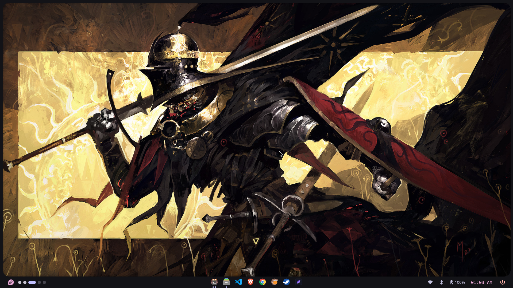
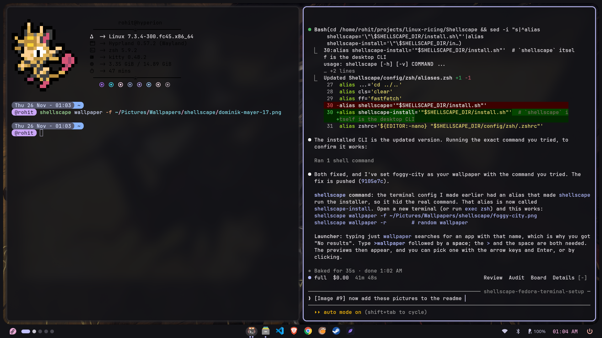
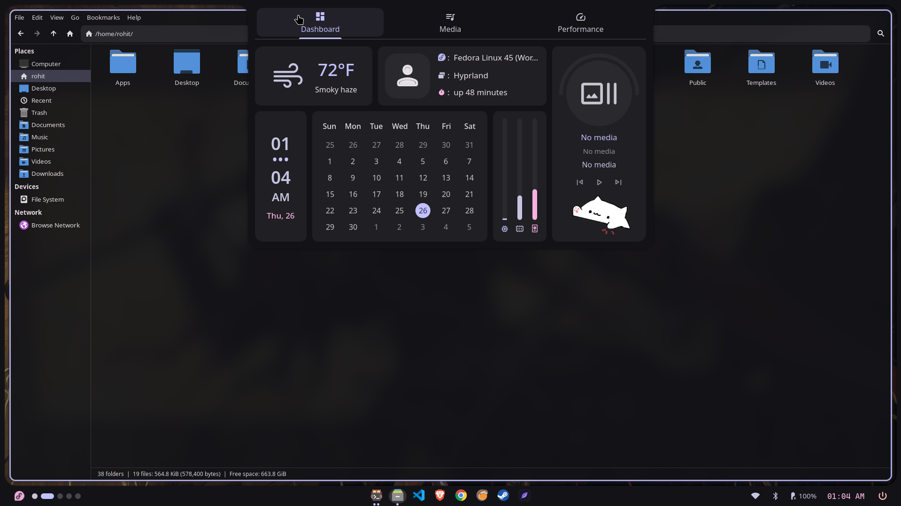
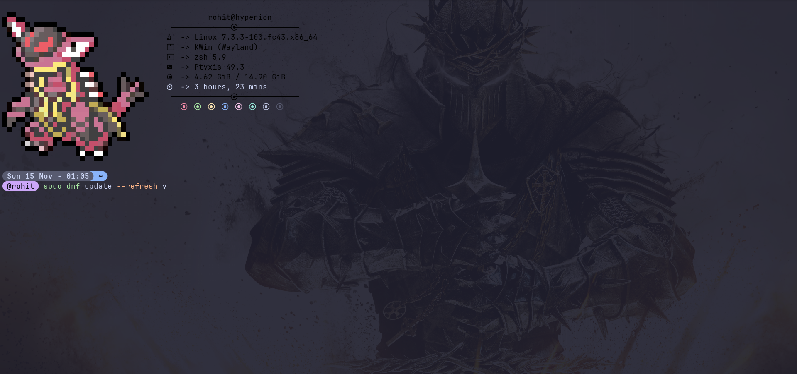

# Shellscape

A one-command setup for **Fedora** that gives you two things:

1. **A themed terminal**: zsh with a custom prompt, kitty, modern command-line
   tools, tmux and a fastfetch/Pokémon banner. It works in any desktop,
   including KDE Plasma.
2. **A complete Hyprland desktop**: a tiling window manager with a bottom
   taskbar, app launcher, dashboard, notifications, lock screen and a colour
   scheme that follows your wallpaper. It installs *next to* your current
   desktop; you choose it at the login screen.



```bash
git clone git@github.com:rohit-etherusx/shellscript.git ~/projects/linux-ricing/Shellscape
cd ~/projects/linux-ricing/Shellscape
./install.sh
```

Then log out, pick **Hyprland (uwsm-managed)** at the login screen, and tap the
**Super** (Windows) key to open the launcher.

---

## Contents

- [Screenshots](#screenshots)
- [What you get](#what-you-get)
- [Install](#install)
- [First steps](#first-steps)
- [Keyboard shortcuts](#keyboard-shortcuts)
- [Customising](#customising)
- [Where everything lives](#where-everything-lives)
- [Troubleshooting](#troubleshooting)
- [Uninstalling](#uninstalling)
- [How it's built](#how-its-built)
- [Credits](#credits)

---

## Screenshots

| | |
|---|---|
|  |  |
| Terminals with the wallpaper's colours | The dashboard (click the clock or the Fedora logo) |

The terminal setup on KDE Plasma:



---

## What you get

### Terminal (any desktop)

| | |
|---|---|
| **Shell** | zsh + Oh-My-Zsh with the `shellscape` prompt (rounded segments for time, folder, git status and user), autosuggestions, syntax highlighting |
| **Terminal** | kitty with JetBrainsMono Nerd Font, slight transparency with blur, cursor trail, powerline tabs. On KDE it becomes the default terminal on `Ctrl+Alt+T` |
| **Tools** | `eza` (ls), `bat` (cat and man pages), `fzf` (`Ctrl+R` history search), `zoxide` (`z <folder>`), `ripgrep`, `fd` |
| **Banner** | fastfetch system info with the Fedora logo, or a random Pokémon sprite, on every new terminal |
| **tmux** | `Ctrl+A` prefix, mouse support, vi keys, themed status bar, plugin manager |
| **Also styled** | Ptyxis (Fedora's stock terminal), foot, fish, starship |
| **KDE extras** | Glide, wobbly-window and magic-lamp animations, blur and translucency |

### Hyprland desktop

| | |
|---|---|
| **Taskbar** | One bar at the bottom: Fedora logo and workspaces on the left, pinned apps and open windows in the middle, tray, Wi-Fi, Bluetooth, battery, clock and power on the right |
| **Launcher** | Tap Super, type to find apps. Also does calculations, wallpapers, colour schemes, light/dark mode and power actions |
| **Dashboard** | Weather, calendar, system info, CPU/RAM/storage meters and a media player |
| **Desktop** | Notifications, volume/brightness pop-ups, lock screen, power menu, screenshots and screen recording, clipboard history, emoji picker, colour picker |
| **Colours** | Picking a wallpaper generates a matching colour scheme for the taskbar, window borders, terminals, GTK and Qt apps, btop and more, live |
| **Windows** | Tiling with gaps, rounded corners, blur, shadows and animations. Extra pop-up workspaces for music, chat and a system monitor |
| **Wallpapers** | 16 wallpapers included in `wallpaper/`, plus Fedora's default |
| **Optional extras** | VS Code, Firefox/Zen, Spotify and Discord themes that follow the wallpaper colours (see [Install](#install)) |

---

## Install

### Requirements

- **Fedora** with `sudo` access. The installer stops on any other distro. The
  terminal part was built on Fedora 43; the Hyprland desktop needs **Fedora 45**,
  because it uses Hyprland 0.57.
- Internet access for Fedora's package repositories. Most other downloads (fonts,
  Oh-My-Zsh, plugins) ship inside `vendor/`; see [Offline use](#offline-use).

### Run it

```bash
./install.sh                    # asks once for your sudo password, then confirms a few choices
./install.sh --yes              # same, but answers "yes" to every question
./install.sh --list             # show every step and what it does
./install.sh --only 92          # run one step (by number or name: "92", "shellscape-shell")
./install.sh --skip pokemon     # leave a step out
./install.sh --with vscode      # also run an optional step
```

**Re-running is always safe.** Each step checks what's already done and only
fixes what's missing, so after an update, or if something failed, just run
`./install.sh` again. Every run writes a log to `logs/`.

### Steps

| Step | What it does |
|---|---|
| `00-preflight` | Checks for Fedora, sudo and internet; installs git, curl, unzip, tar, xz |
| `10-fonts` | Fedora fonts and the JetBrainsMono Nerd Font (the icons in the prompt and taskbar need it) |
| `20-cli-tools` | eza, bat, fzf, zoxide, ripgrep, fd |
| `30-zsh` | zsh, Oh-My-Zsh, plugins and prompt themes; offers to make zsh your login shell |
| `40-kitty` | kitty and its config; on KDE, sets it as the default terminal |
| `45-ptyxis` | Gives Fedora's Ptyxis terminal the same font and colours |
| `50-fastfetch` | System-info banner with the Fedora logo |
| `60-tmux` | tmux, its config and plugins |
| `70-pokemon` | Pokémon sprites for the banner |
| `80-kde-effects` | KDE window animations and blur (asks first) |
| `90-hyprland` | Hyprland and its tools, the session setup and the Hyprland config |
| `91-shellscape-cli` | The `shellscape` command (wallpapers, colour schemes, screenshots, recording) |
| `92-shellscape-shell` | The desktop itself (taskbar, launcher, dashboard, lock screen), its fonts, and the default wallpaper |
| `93-desktop-apps` | foot, fish, starship, btop, Qt/GTK theming; makes GNOME Settings work under Hyprland |
| `95-vscode` *(optional)* | VS Code settings and a theme that follows the wallpaper. **Replaces your VS Code settings** (with a backup) |
| `96-browser` *(optional)* | Firefox/Zen theme; install the CaelestiaFox add-on for live colours |
| `97-spotify` *(optional)* | Spotify (Flatpak) themed with Spicetify |
| `98-discord` *(optional)* | Vesktop (Flatpak) with a theme that follows the wallpaper |

The full package list is in [PACKAGES.md](PACKAGES.md).

### After installing

1. **Log out.** At the login screen, pick **Hyprland (uwsm-managed)**. The plain
   **Hyprland** entry works too.
2. Your KDE (or GNOME) session is untouched; pick it at the login screen to go back.
3. Your login shell is now zsh. In KDE, `Ctrl+Alt+T` opens kitty.

---

## First steps

**Open apps.** Tap **Super** and start typing, then press Enter. Or click an app
in the middle of the taskbar.

**The taskbar.**
- **Click** an app to open it, or to jump to it if it's already open. The dots
  under an icon are its open windows.
- **Middle-click** opens another window of that app.
- **Right-click** pins an app to the taskbar, or unpins it.
- **Click a workspace dot** to switch workspace.
- **Click the Fedora logo or the clock** to open the dashboard.
- **Click Wi-Fi or Bluetooth** for those settings.
- **Click the power icon** for lock, log out, restart and shut down.

**Change the wallpaper.** Tap Super, type **`>wallpaper`** followed by a
**space**, then pick one. The whole desktop recolours itself to match. From a
terminal:

```bash
shellscape wallpaper -f ~/Pictures/Wallpapers/shellscape/foggy-city.png
shellscape wallpaper -r      # random wallpaper
```

**More launcher commands.** Type `>` in the launcher to list them:
`>calc 2+2`, `>scheme` (colour scheme), `>variant` (scheme style), `>light`,
`>dark`, `>transparency`, `>random` (random wallpaper), `>lock`, `>sleep`,
`>logout`, `>reboot`, `>shutdown`.

**Settings.**
- **Super+I**: quick settings for Wi-Fi, Bluetooth and audio.
- **Settings** (GNOME Settings) and **System Settings** (KDE) both open from the
  launcher, for displays, users and everything else.

---

## Keyboard shortcuts

**Super** is the Windows key. Tapping it on its own opens the launcher; holding
it with another key runs that shortcut instead.

### Apps

| Keys | Action |
|---|---|
| `Super+T` | Terminal (kitty) |
| `Super+B` | Browser |
| `Super+E` | Files (Thunar) |
| `Super+C` | Code editor (VS Code) |
| `Super+I` | Quick settings (Wi-Fi, Bluetooth, audio) |
| `Ctrl+Alt+V` | Volume mixer |
| `Ctrl+Alt+Esc` | Process manager |

### Windows

| Keys | Action |
|---|---|
| `Super+Q` | Close window |
| `Super+F` | Fullscreen |
| `Super+Alt+F` | Maximise (keeps the taskbar and gaps) |
| `Super+Alt+Space` | Toggle floating / tiled |
| `Super+P` | Pin window to every workspace |
| `Super+Arrows` | Move focus |
| `Super+Shift+Arrows` | Move window |
| `Super`+drag with the left mouse button, or `Super+Z` | Move a window with the mouse |
| `Super`+drag with the right mouse button, or `Super+X` | Resize a window with the mouse |
| `Super+Minus` / `Super+Equal` | Shrink / grow the split |
| `Ctrl+Super+\` | Centre window |
| `Super+Alt+\` | Picture-in-picture |
| `Alt+Tab` | Next window |

### Workspaces

| Keys | Action |
|---|---|
| `Super+1` … `Super+0` | Go to workspace 1–10 |
| `Super+Alt+1` … `Super+Alt+0` | Send window to workspace 1–10 |
| `Ctrl+Super+Left/Right`, or `Super`+scroll | Previous / next workspace |
| `Super+S` | Show / hide the scratch workspace |
| `Super+Alt+S` | Send window to the scratch workspace |
| `Super+M` | Music workspace |
| `Super+D` | Chat workspace |
| `Ctrl+Shift+Esc` | System monitor (btop) |

### Screenshots and recording

| Keys | Action |
|---|---|
| `Print` | Whole screen, copied to the clipboard |
| `Super+Shift+S` | Select an area (the screen freezes while you choose) |
| `Super+Alt+R` | Record the screen with sound |
| `Ctrl+Alt+R` | Record the screen |
| `Super+Shift+Alt+R` | Record an area |
| `Super+Shift+C` | Colour picker |

Screenshots go to `~/Pictures/Screenshots`, recordings to `~/Videos/Recordings`.

### Clipboard, emoji and media

| Keys | Action |
|---|---|
| `Super+V` | Clipboard history |
| `Super+.` | Emoji picker |
| `Ctrl+Super+Space` | Play / pause |
| `Ctrl+Super+=` / `Ctrl+Super+-` | Next / previous track |
| `Super+Shift+M` | Mute |

### Session

| Keys | Action |
|---|---|
| `Super+L` | Lock screen |
| `Ctrl+Alt+Delete` | Power menu |
| `Super+Shift+L` | Sleep |
| `Super+K` | Show all panels |
| `Ctrl+Alt+C` | Clear notifications |
| `Ctrl+Super+Alt+R` | Restart the desktop shell (if the taskbar misbehaves) |

The full list is in [`config/hypr/hyprland/keybinds.lua`](config/hypr/hyprland/keybinds.lua).

### In the terminal

| Keys | Action |
|---|---|
| `Ctrl+R` | Search command history |
| `Ctrl+T` | Find a file |
| `Alt+C` | Jump to a folder |
| `z <name>` | Jump to a folder you've visited |
| `Esc Esc` | Put `sudo` in front of the current command |
| `Ctrl+Shift+Enter` / `Ctrl+Shift+T` | New kitty window / tab in the same folder |
| `Ctrl+Shift+Left/Right` | Previous / next kitty tab |
| `Ctrl+Shift+=` / `-` / `0` | Bigger / smaller / reset font |

**tmux** (press `Ctrl+A` first): `|` and `-` split the window, `h` `j` `k` `l`
move between panes (`H` `J` `K` `L` resize them), `c` opens a new window,
`r` reloads the config, `I` installs plugins.

---

## Customising

All config files live in this folder and are **linked** into your home folder,
so editing a file here changes your setup immediately. Settings that should
apply to this computer only go in `~/.config/shellscape/` instead, which is not
part of the repo.

### Desktop

| To change | Do this |
|---|---|
| **Pinned apps** | Right-click apps on the taskbar, or edit `dock.pinned` in `~/.config/shellscape/shell.json` (a list of `.desktop` file names without the extension) |
| **Default apps** (Super+T/B/E/C) | Add lines to `~/.config/shellscape/hypr-vars.lua`, e.g. `V.browser = "brave-browser"`, `V.terminal = "foot"` |
| **Keyboard layout** | `V.kbLayout = "de"` (and `V.kbVariant`) in the same file |
| **Night light** | It warms the screen after sunset. Turn it off with `V.nightLight = false` in the same file |
| **Gaps, blur, rounding, opacity, cursor** | Copy the variable from [`config/hypr/variables.lua`](config/hypr/variables.lua) into `hypr-vars.lua` and change it |
| **Monitors** | e.g. `hl.monitor({ output = "DP-1", mode = "2560x1440@144", position = "0x0", scale = 1 })` in `~/.config/shellscape/hypr-user.lua` |
| **Your own keybinds** | `hl.bind("Super + G", hl.dsp.exec_cmd("gimp"))` in `hypr-user.lua` |
| **Wallpapers** | Drop images into `wallpaper/` (shared via git) or `~/Pictures/Wallpapers` (this computer only). Press `Ctrl+Super+Alt+R` afterwards so the picker sees new files in `wallpaper/` |
| **Colour scheme** | `>scheme` in the launcher, or `shellscape scheme list` / `shellscape scheme set -n gruvbox -f hard`. The `dynamic` scheme follows the wallpaper |
| **Everything else in the shell** | `~/.config/shellscape/shell.json`; see the options in [`desktop/shell/config/`](desktop/shell/config/) |

Hyprland changes apply when you save the file. If something is wrong, Hyprland
shows the error at the top of the screen; check a file without applying it with
`Hyprland --verify-config -c ~/.config/hypr/hyprland.lua`.

### Terminal

| To change | Where |
|---|---|
| Prompt theme | `ZSH_THEME` in `config/zsh/.zshrc`. The default `shellscape` theme is in `config/zsh/themes/`; also included: `agnosterzak antares bullet-train color-input comfyline emoji fishbone++` |
| Startup banner | `SHELLSCAPE_BANNER="fastfetch"`, `"pokemon"` or `"none"` in `config/zsh/.zshrc` (`SHELLSCAPE_BANNER_ANIM=0` turns off the line-by-line reveal) |
| Aliases | `config/zsh/aliases.zsh` |
| kitty | `config/kitty/kitty.conf` and `theme.conf` |
| tmux | `config/tmux/tmux.conf` |
| Things only for this computer | `~/.zshrc.local` (loaded last, not in the repo) |

Handy aliases: `ls`/`l`/`la`/`lt` (eza listings), `cat` (bat), `update`,
`install`, `remove`, `search` (dnf), `ff` (fastfetch), `zshrc` (edit the zsh
config), `shellscape-install` (re-run the installer from anywhere).

---

## Where everything lives

```
Shellscape/
├── install.sh            the installer: runs modules/ in order
├── uninstall.sh          undoes it (see Uninstalling)
├── vendor.sh             refreshes the offline copies in vendor/
├── PACKAGES.md           every package and where it comes from
├── modules/              one install step per file (NN-name.sh)
├── lib/common.sh         shared installer helpers
├── config/               all config files, linked into ~/.config
│   ├── hypr/             Hyprland (Lua): hyprland.lua, variables.lua, hyprland/*.lua
│   ├── zsh/ kitty/ tmux/ fastfetch/ eza/ bat/
│   ├── foot/ fish/ starship.toml btop/ micro/ qt5ct/ qt6ct/ uwsm/ thunar/
│   ├── systemd/          session file that starts the portal and polkit agent
│   └── vscode/ firefox/ zen/ spicetify/ zed/   used by the optional steps
├── desktop/
│   ├── shell/            the desktop shell (Quickshell/QML), linked to ~/.config/quickshell/shellscape
│   ├── cli/              the `shellscape` command (Python)
│   └── UPSTREAM          which upstream versions were imported
├── wallpaper/            wallpapers, linked to ~/Pictures/Wallpapers/shellscape
├── vendor/               offline copies of the non-Fedora downloads
├── docs/                 screenshots
├── tools/absorb.sh       re-imports the upstream Caelestia code
└── tests/selection.sh    test for the installer's --only/--skip/--with options
```

Anything that already existed in your home folder is moved to
`<name>.bak.<date>` before Shellscape links its own file there, and
`./uninstall.sh` puts it back.

Your own settings, outside the repo:

| File | What it's for |
|---|---|
| `~/.config/shellscape/shell.json` | Shell settings, including pinned apps |
| `~/.config/shellscape/hypr-vars.lua` | Your Hyprland variables (apps, keyboard, night light) |
| `~/.config/shellscape/hypr-user.lua` | Any extra Hyprland config (monitors, keybinds) |
| `~/.local/state/shellscape/` | Current wallpaper and colour scheme |
| `~/.zshrc.local` | Your own zsh additions |

### Offline use

`vendor/` holds compressed copies of everything that isn't a Fedora package:
the Nerd Font, Oh-My-Zsh, the zsh and tmux plugins and the Pokémon sprites. The
installer uses these first. A fresh install still needs Fedora's repositories
and a few desktop downloads from GitHub (app2unit, Material Symbols and the
CaskaydiaCove font); `./vendor.sh` adds app2unit and Material Symbols to
`vendor/` too. Copy the folder anywhere (git, USB, rsync) and run
`./install.sh`. If you move the folder after installing, run `./install.sh` again
to update the links.

---

## Troubleshooting

**No taskbar, or Super does nothing, after logging in to Hyprland.** Press
`Ctrl+Super+Alt+R` to restart the shell. If it still doesn't appear, run
`qs -c shellscape log` in a terminal (`Super+T`) and look for `ERROR` lines.

**Hyprland shows a red error bar at the top.** A config file has a mistake. Run
`Hyprland --verify-config -c ~/.config/hypr/hyprland.lua` to see which line.

**"Authentication agent missing" or "XDG desktop portal missing" on first login.**
Run `./install.sh --only 90` and log in again. That step installs the session
file that starts both services.

**The launcher finds nothing for "wallpaper".** Type `>wallpaper` followed by a
space; without the `>` it searches for apps.

**New wallpapers don't show in the picker.** Press `Ctrl+Super+Alt+R`.

**`shellscape` runs the installer instead of the desktop command.** Your zsh
config is older than this version. Re-run `./install.sh --only 30` or open a new
terminal; the installer alias is now `shellscape-install`.

**The screen looks warm or yellow in the evening.** That's night light; see
[Customising](#desktop).

**A settings app won't open.** GNOME Settings needs `./install.sh --only 93`
(it normally refuses to run outside GNOME). KDE System Settings works as-is.

**Boxes or stray letters instead of icons in the prompt.** The terminal isn't
using a Nerd Font. kitty is set up already; for Ptyxis run
`./install.sh --only ptyxis`; for other terminals pick "JetBrainsMono Nerd Font".

**tmux plugins missing.** Press `Ctrl+A` then `I` inside tmux.

**Something failed during install.** Read the newest file in `logs/`, then run
`./install.sh` again. It only redoes what's missing.

---

## Uninstalling

```bash
./uninstall.sh            # remove Shellscape's links, put your old files back, offer to switch back to bash
./uninstall.sh --purge    # also offers to remove Oh-My-Zsh, fonts, the desktop and the installed packages
```

`--purge` asks before each removal.

---

## How it's built

**Terminal.** The zsh, kitty and fastfetch setup started from
[JaKooLit's Arch-Hyprland](https://github.com/JaKooLit/Arch-Hyprland) dotfiles,
ported to Fedora's `dnf` and extended.

**Desktop.** The desktop is the Fedora fork of the
[Caelestia](https://github.com/caelestia-dots) dotfiles, absorbed into this repo
and renamed to Shellscape. `tools/absorb.sh` copies the upstream repos (cloned
next to this folder), renames every `caelestia` to `shellscape`, and fails if any
old name is left. The exception is the `caelestiafox` id, which the published
Firefox add-on looks for by name.

Changes on top of upstream:

- **Hyprland 0.57.** It replaced the old config format with Lua and changed its
  command syntax. The whole Hyprland config is rewritten in Lua, and the shell
  and the `shellscape` command use the new commands.
- **One bottom taskbar** with pinned apps, replacing Caelestia's left bar.
- **Fedora packaging.** Hyprland, Quickshell and starship come from Fedora COPR
  repositories; app2unit and the shell's audio and idle helpers are built from source.
- **Session fixes.** The desktop portal and polkit agent start from either login entry.
- **Fixes:** a Super shortcut no longer also opens the launcher; theming no
  longer stops halfway when a Sass compiler is missing; the launcher no longer
  breaks when apps are installed; GNOME Settings works; US keyboard layout
  instead of the fork author's French one.

**Adding your own install step.** Create `modules/NN-name.sh` and make it
executable; `install.sh` picks it up automatically:

```bash
#!/usr/bin/env bash
# desc: One-line description shown by --list
source "$(dirname "$(readlink -f "$0")")/../lib/common.sh"

install_pkgs some-package another-package
link_dotfile "$CONFIG_DIR/whatever" "$HOME/.config/whatever"
```

Add a line containing only `# optional` to make it run only with `--with`.
Helpers in `lib/common.sh`: `install_pkgs`, `link_dotfile`, `enable_copr`,
`git_clone`, `download`, `run_logged`, `ask_yes_no`, `need_cmd`, and the log
functions `ok`, `info`, `note`, `warn`, `die`.

---

## Credits

- Desktop: [caelestia-dots](https://github.com/caelestia-dots) by soramane and the
  [Fedora fork](https://github.com/EnceladusII/caelestia-fedora) by EnceladusII.
  The shell and command-line tool are GPL-3.0; their licences are kept in
  `desktop/shell` and `desktop/cli`, so those parts of Shellscape are GPL-3.0 too.
- Terminal starting point: [JaKooLit/Arch-Hyprland](https://github.com/JaKooLit/Arch-Hyprland)
- Window manager: [Hyprland](https://hyprland.org); widgets: [Quickshell](https://quickshell.outfoxxed.me)
- Colours: [Catppuccin](https://github.com/catppuccin) and Material You
- Fonts: [Nerd Fonts](https://github.com/ryanoasis/nerd-fonts) (JetBrains Mono, CaskaydiaCove), Google Material Symbols
- Shell framework: [Oh-My-Zsh](https://ohmyz.sh) and the [zsh-users](https://github.com/zsh-users) plugins
- Sprites: [pokemon-colorscripts](https://gitlab.com/phoneybadger/pokemon-colorscripts)
